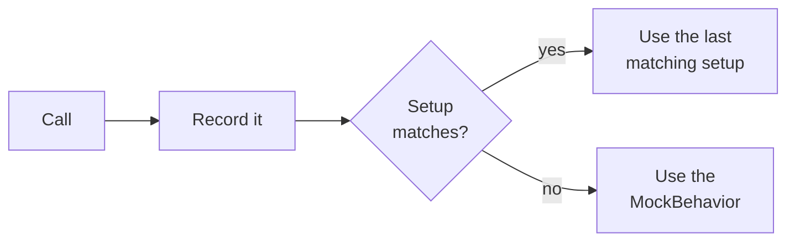

# Core concepts

## Mocks and the system under test

A test usually checks one class, the *system under test* (SUT). The SUT talks to collaborators such as a database, a
web service or a hardware device. A *mock* replaces such a collaborator: it implements the same interface (or derives
from the same class), lets you decide what it returns, and records how it was called.

Throughout this documentation the examples use this collaborator:

```csharp
public delegate void ChocolateDispensedDelegate(string type, int amount);

public interface IChocolateDispenser
{
    int this[string type] { get; set; }
    int TotalDispensed { get; set; }
    bool Dispense(string type, int amount);
    event ChocolateDispensedDelegate ChocolateDispensed;
}
```

The mock is called `dispenser`, and the class that uses it is called `sut`:

```csharp
IChocolateDispenser dispenser = IChocolateDispenser.CreateMock();
VendingMachine sut = new VendingMachine(dispenser);
```

Pages that need further members declare them next to the example.

## The `Mock` accessor

The source generator adds a `CreateMock()` method to every type you mock. The returned object *is* an
`IChocolateDispenser`, so you can pass it to your code directly. Everything that configures or inspects the mock is
reached through its `Mock` property:

| Member                                                       | Purpose                                                                                                     |
|--------------------------------------------------------------|-------------------------------------------------------------------------------------------------------------|
| `Mock.Setup`                                                 | Decide how methods, properties and indexers behave. See [Setup](../05-setup/01-methods.md).                       |
| `Mock.Raise`                                                 | Raise events on the mock. See [Events](../05-setup/04-events.md).                                                 |
| `Mock.Verify`                                                | Check how the mock was used. See [Verify interactions](../07-verify-interactions.md).                          |
| `Mock.SetupProtected`, `Mock.VerifyProtected`, …             | The same for protected members of class mocks. See [Protected members](../08-advanced-features/01-protected-members.md). |
| `Mock.SetupStatic`, `Mock.VerifyStatic`, …                   | The same for static interface members. See [Static interface members](../08-advanced-features/02-static-interface-members.md). |
| `Mock.InScenario(…)`, `Mock.TransitionTo(…)`                 | Switch between sets of setups. See [Scenarios](../08-advanced-features/06-scenarios.md).                          |
| `Mock.Monitor()`, `Mock.ClearAllInteractions()`              | Limit which interactions are counted. See [Monitor interactions](../08-advanced-features/04-monitor-interactions.md). |
| `Mock.As<T>()`                                               | Reach an additional interface. See [Create mocks](../04-create-mocks.md#implementing-additional-interfaces).  |

The generated setup and verification members mirror the members of the mocked type, so a typo or a wrong argument type
is a compile error instead of a runtime exception.

## What happens when the mock is called

Each call to the mock goes through the same steps:

1. The call is **recorded**, so that you can verify it later.
2. Mockolate looks for a **matching setup**. A setup matches when every argument satisfies its
   [parameter matcher](../06-parameter-matching.md). If several setups match, the one defined **last** wins.
   The setup's callbacks run, and its return value or exception is used.
3. Without a matching setup, the mock falls back to its [`MockBehavior`](../04-create-mocks.md#customizing-mock-behavior):
   - methods return a **default value**: `false`, `0`, an empty string, an empty collection, a completed task, or
     `null` for other reference types;
   - properties and indexers behave like **normal storage**: reading returns the value that was last written, or the
     default value if nothing was written yet;
   - a mock created with `ThrowingWhenNotSetup()` throws a `MockNotSetupException` instead.



```csharp
dispenser.Mock.Setup.Dispense(It.IsAny<string>(), It.IsAny<int>()).Returns(true);
dispenser.Mock.Setup.Dispense("White", It.IsAny<int>()).Returns(false);

bool dark = dispenser.Dispense("Dark", 1);
bool white = dispenser.Dispense("White", 1);

await That(dark).IsTrue().Because("only the first setup matches");
await That(white).IsFalse().Because("both setups match and the later one wins");

int before = dispenser.TotalDispensed;
dispenser.TotalDispensed = 5;
int after = dispenser.TotalDispensed;

await That(before).IsEqualTo(0).Because("nothing was written yet");
await That(after).IsEqualTo(5).Because("the property stores the written value");
```

:::tip

Define general setups first and more specific ones afterwards.

:::

Because the last matching setup wins, every `dispenser.Mock.Setup.X` statement starts a **new** setup that replaces
earlier ones with the same arguments. Configure one setup by chaining:

```csharp
// ✔️ One setup: the property starts at 42 and logs every write
dispenser.Mock.Setup.TotalDispensed
    .InitializeWith(42)
    .OnSet.Do(newValue => Console.WriteLine(newValue));

// ❌ Two setups: the second one replaces the first, so the property starts at 0
dispenser.Mock.Setup.TotalDispensed.InitializeWith(42);
dispenser.Mock.Setup.TotalDispensed.OnSet.Do(newValue => Console.WriteLine(newValue));
```

:::note[Class mocks]

A class mock also calls the **base class implementation** of a virtual member, even when a setup matches. The setup's
return value takes precedence; the base class result is used only when no setup provides one. Use
[`SkippingBaseClass()`](../04-create-mocks.md#customizing-mock-behavior) to turn the base class calls off.

:::

## Verifications

Verifications count the recorded interactions that match the given arguments and compare the count with your
expectation. Nothing is checked until you call a count method such as `.Once()`, `.Never()` or `.AtLeast(2)`;
the [Mockolate0001](../10-analyzers.md#mockolate0001) analyzer warns you when you forget it.

```csharp
dispenser.Dispense("Dark", 1);

dispenser.Mock.Verify.Dispense("Dark", It.IsAny<int>()).Once();  // passes
dispenser.Mock.Verify.Dispense("Milk", It.IsAny<int>()).Once();  // throws a MockVerificationException
```

The exception message describes the expectation and what actually happened:

```text title="Failure message"
Expected that mock invoked method Dispense("Milk", It.IsAny<int>()) exactly once, but it never did.
```

Setups and verifications are independent: you can verify calls that have no setup, and a setup does not expect to
be called. To check that every setup was used or every interaction was verified, see
[Check for unexpected interactions](../08-advanced-features/05-check-for-unexpected-interactions.md).

## See it all together

- [A complete example](01-complete-example.md) combines these concepts in one end-to-end test.
- The [cheat sheet](02-cheat-sheet.md) lists the most common calls on one page.
